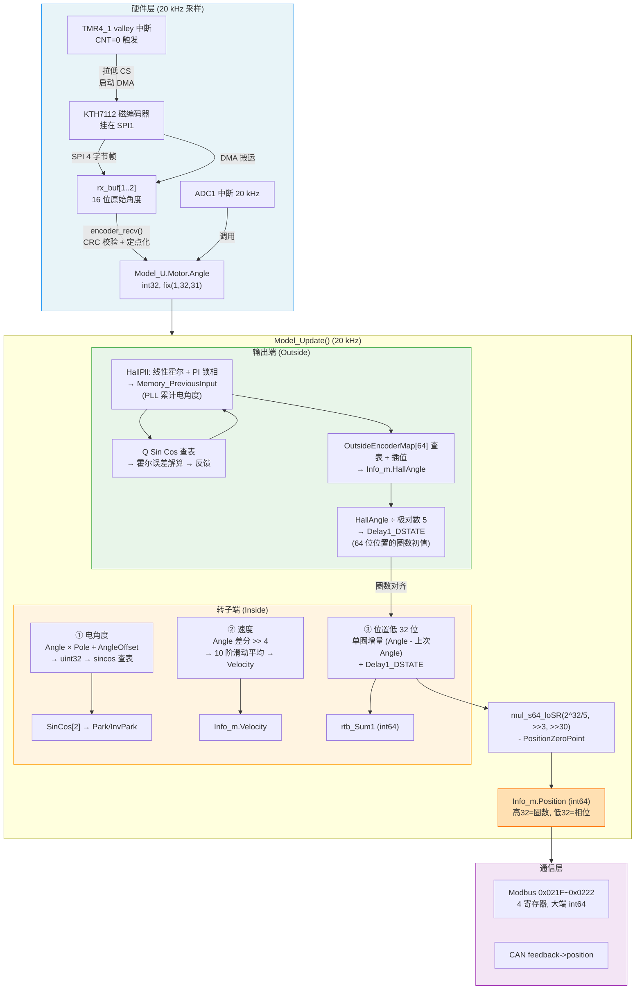
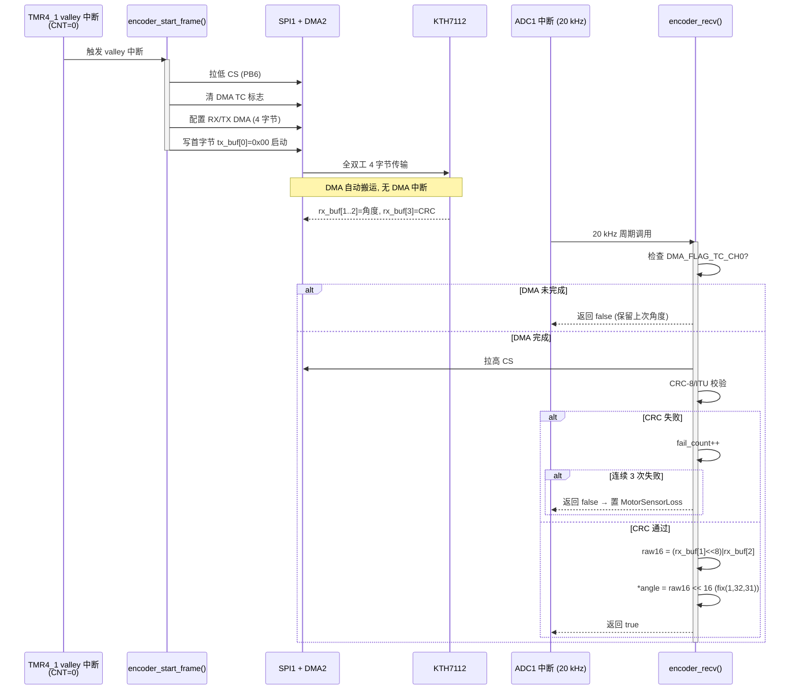
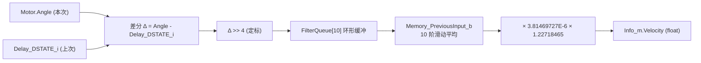
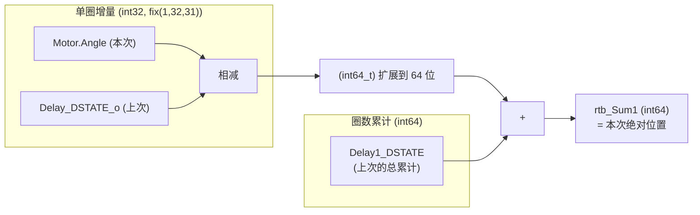
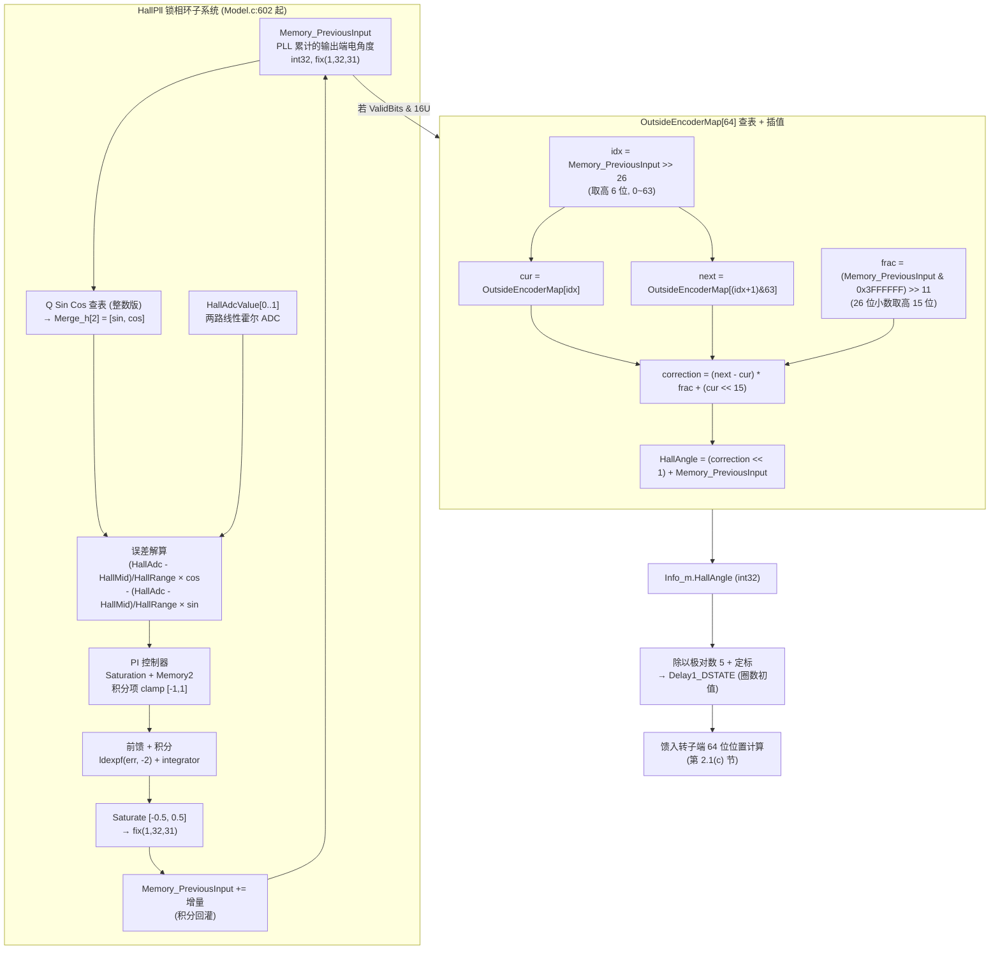
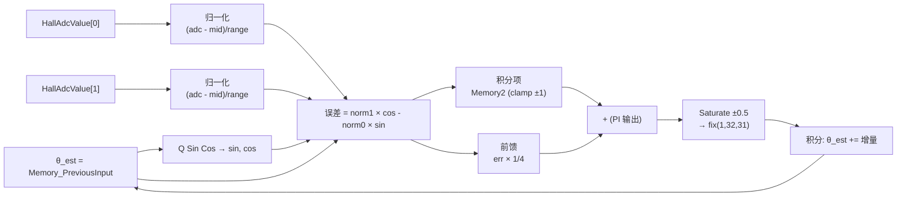
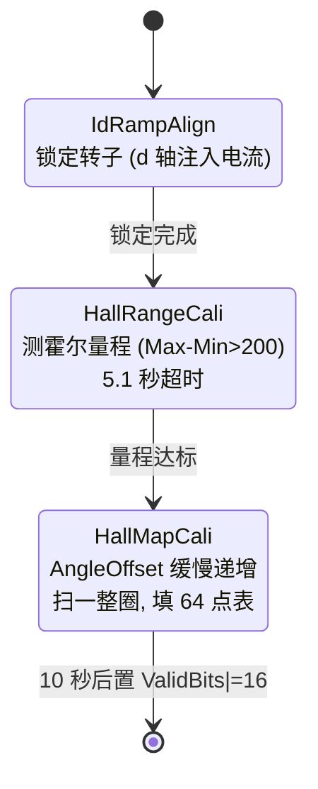
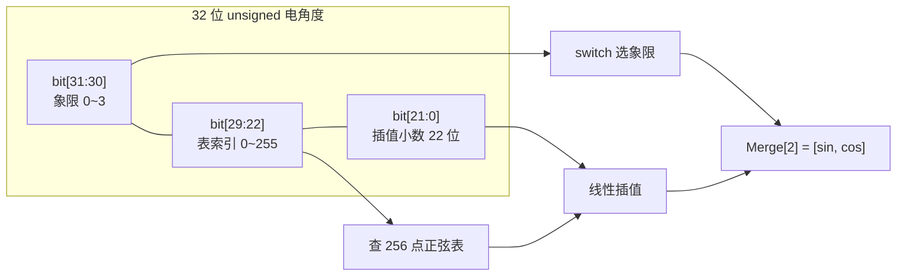
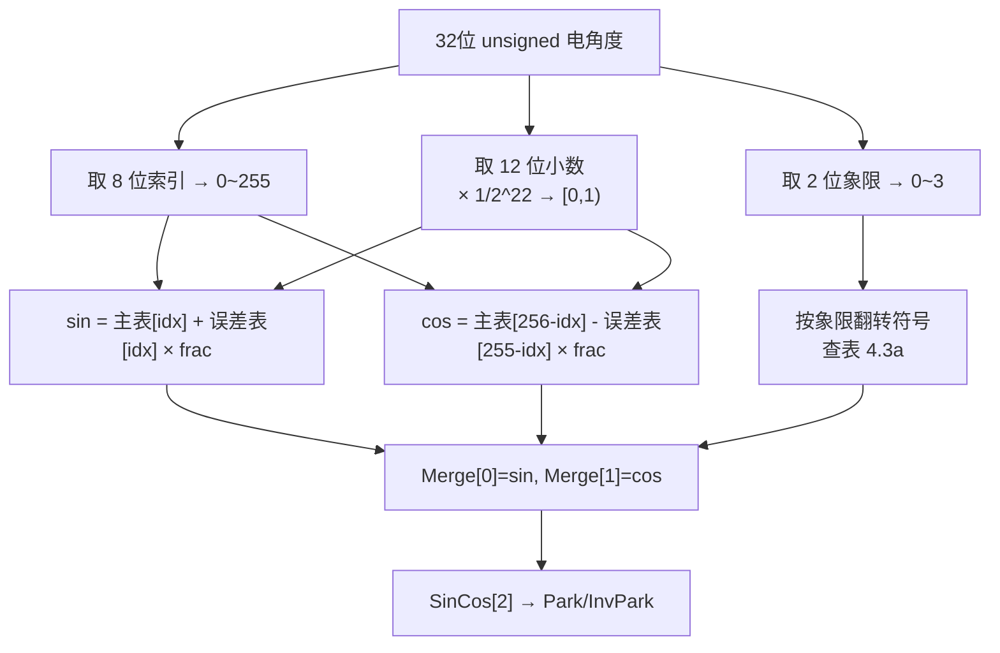
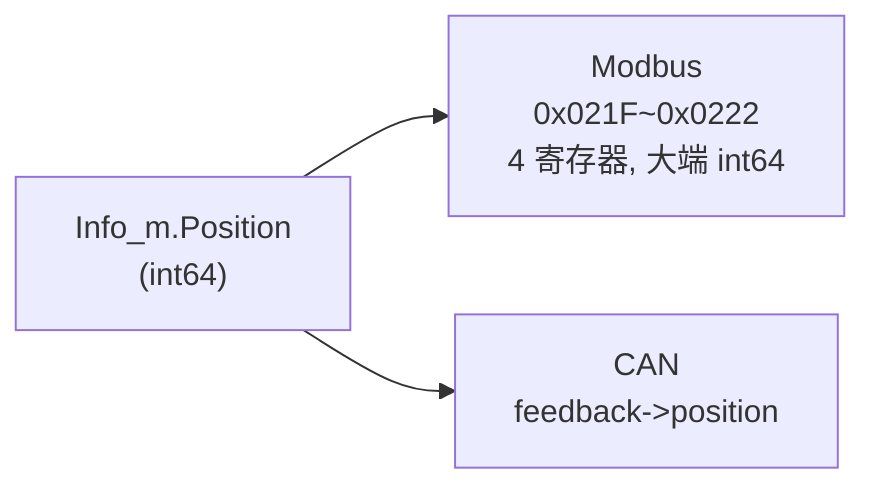

# 电机角度处理流程总结

本文档梳理这套电机控制固件里"角度"从编码器原生数据到 [`Model_Y.Info.Position`](Model/Code/Model_ert_rtw/Model.h:317) 输出的完整链路，重点回答五个问题：

1. "编码器原生数据"是什么、怎么采进来的
2. **转子端位置是怎么获取的**（从 SPI 字节到 64 位位置的每一步）
3. **输出端位置是怎么获取的**（HallPll + OutsideEncoderMap 查表的每一步）
4. unsigned 数据区是怎么参与 sincos 计算的
5. [`Model_Y.Info.Position`](Model/Code/Model_ert_rtw/Model.h:317) 这个 64 位角度的位域分配

> 阅读建议：先看第 0 节的"全景流程图"建立整体印象，再按顺序往下看细节。每节都有 mermaid 图或表格，文字只负责补图说不清的"为什么"。

---

## 0. 全景流程图（先看这张）



---

## 1. 编码器原生数据是什么

### 1.1 硬件层

编码器是 **KTH7112 磁编码器**，挂在 SPI1 上，由 TMR4_1 调度触发，DMA 搬运数据，不需要专门的 DMA 中断。相关代码在 [`Hardware/encoder.c`](Hardware/encoder.c:1)。

**SPI 帧格式（4 字节全双工）**：

| 字节         | 方向 | 含义              | 备注                          |
| ------------ | ---- | ----------------- | ----------------------------- |
| `tx_buf[0]`  | MOSI | `0x00` 命令字节   | 读角度命令                    |
| `tx_buf[1]`  | MOSI | `0xFF` dummy      | 凑满 4 字节帧                 |
| `tx_buf[2]`  | MOSI | `0xFF` dummy      | 同上                          |
| `tx_buf[3]`  | MOSI | `0xFF` dummy      | 同上                          |
| `rx_buf[0]`  | MISO | （忽略）          | 命令字节回响                  |
| `rx_buf[1]`  | MISO | **角度高字节**    | raw16 的高 8 位               |
| `rx_buf[2]`  | MISO | **角度低字节**    | raw16 的低 8 位               |
| `rx_buf[3]`  | MISO | CRC-8/ITU 校验字节| 对 `rx_buf[1..2]` 校验        |

> 这 4 个字节就是"编码器原生数据"。真正承载角度的只有 `rx_buf[1..2]` 这 2 个字节，是一个 **16 位无符号原始角度**，对应一圈 0~65535。

### 1.2 触发与接收时序（mermaid 时序图）

整个采集过程被拆成两段，由两个中断驱动：TMR4_1 valley 中断"启动"，ADC1 中断"收割"。这样设计是因为 SPI 传输需要几个微秒，放在同一个中断里会阻塞 ADC 的 20 kHz 节拍。



### 1.3 原生角度 → 定点角度的换算

关键的一行在 [`Hardware/encoder.c:228`](Hardware/encoder.c:228)：

```c
*angle = (int32_t)((((uint32_t)rx_buf[1] << 8) | rx_buf[2]) << 16);
```

| 步骤 | 表达式                                          | 类型             | 范围 / 含义                            |
| ---- | ----------------------------------------------- | ---------------- | -------------------------------------- |
| 1    | `rx_buf[1] << 8 \| rx_buf[2]`                   | `uint32_t`       | 拼成 16 位原始角度 raw16, 范围 0~65535 |
| 2    | `raw16 << 16`                                   | `uint32_t`       | 左移到高 16 位                         |
| 3    | `(int32_t)…`                                    | `int32_t`        | 以有符号解释                           |
| 结果 | `*angle`                                        | fix(1,32,31)     | 1 符号位 + 1 整数位 + 31 小数位        |
|      | 数值范围                                        | [-1, 1) 圈       | 对应 [-180°, 180°)                     |

这个值写入 [`Model_U.Motor.Angle`](Model/Code/Model_ert_rtw/Model.h:51)，是整个模型**唯一的转子端角度输入**。

> **fix(1,32,31) 是什么？** 一种定点小数格式：总 32 位，1 位符号 + 1 位整数 + 31 位小数。`2^31` 代表 1.0 圈（即 360°），`2^30` 代表 0.5 圈（180°）。所以 `raw16 << 16` 把 16 位原始角度放大到 32 位定点，一圈 65535 对应 `0xFFFF0000` = -0.000015 圈（≈ 0），刚好对齐到 [-1,1) 的表达。

> CRC 失败时 [`encoder_recv()`](Hardware/encoder.c:203) 不更新 `*angle`，保留上一次有效值并累计失败次数；连续 3 次失败返回 `false`，调用方 [`ADC1_Handler()`](User/motor.c:64) 会置位 `MotorSensorLoss` 故障。

---

## 2. 转子端位置是怎么获取的

这套固件配的是 **DM-J4310P-2EC 减速电机**，存在两个"角度域"：

| 角度域         | 物理含义           | 数据来源                       | 模型变量                                             |
| -------------- | ------------------ | ------------------------------ | ---------------------------------------------------- |
| **转子端 Inside** | 电机转子直连的角度 | KTH7112 编码器（SPI）          | [`Model_U.Motor.Angle`](Model/Code/Model_ert_rtw/Model.h:51) |
| **输出端 Outside** | 减速器输出轴的角度 | 由转子端角度 + `OutsideEncoderMap` 查表 | [`Model_DW.Info_m.HallAngle`](Model/Code/Model_ert_rtw/Model.h:171) |

### 2.1 转子端角度的三处用途

转子端角度 [`Model_U.Motor.Angle`](Model/Code/Model_ert_rtw/Model.h:51) 在 [`Model_Update()`](Model/Code/Model_ert_rtw/Model.c:416) 里被用在三处，下面分别展开。

#### (a) 计算电角度 → 驱动 sincos 查表

[`Model.c:927`](Model/Code/Model_ert_rtw/Model.c:927)：

```c
rtb_DataTypeConversion3_l = (uint32_t)(Model_U.Motor.Angle * (int32_t)Model_DW.Control.Pole
                                       + Model_DW.Control.AngleOffset);
```

| 项              | 含义                                     | 类型    |
| --------------- | ---------------------------------------- | ------- |
| `Motor.Angle`   | 转子机械角度 fix(1,32,31)                | int32   |
| `Pole`          | 极对数（DM-J4310P-2EC 为 5），把机械角度放大成电角度 | int32   |
| `AngleOffset`   | 电角度零点偏置（由 `CaliAngleOffset` 校准） | int32   |
| 强转 `uint32_t` | 电角度折叠到 [0, 2π)                     | uint32  |

这一步是 signed→unsigned 的关键转换，详见第 4 节。

#### (b) 计算转子端速度

[`Model.c:1161`](Model/Code/Model_ert_rtw/Model.c:1161)：

```c
rtb_ShiftArithmetic_j = (Model_U.Motor.Angle - Model_DW.Delay_DSTATE_i) >> 4;
```

速度计算流程（mermaid）：



- 差分 `Angle - Delay_DSTATE_i` 得到单步角度增量（int32, fix(1,32,31)）
- `>> 4` 是定标，把增量规整到合适范围
- `FilterQueue_DSTATE[10]` 是 10 阶环形缓冲，`CircBufIdx` 在 0~9 之间循环（[`Model.c:1190`](Model/Code/Model_ert_rtw/Model.c:1190)）
- 滑动平均 = `(本次增量 + 累计和 - 最老增量)`，避免每次重算 10 个数的和
- 系数 `3.81469727E-6 = 1/2^18`，`1.22718465` 是把"角度增量/采样"换算成"rpm"的工程系数

#### (c) 累计输出端位置（这是转子端对 64 位位置的直接贡献）

[`Model.c:1153`](Model/Code/Model_ert_rtw/Model.c:1153)：

```c
rtb_Sum1 = (int64_t)(Model_U.Motor.Angle - Model_DW.Delay_DSTATE_o) + Model_DW.Delay1_DSTATE;
```

这一行是 64 位位置的核心，拆开看：



- `Motor.Angle - Delay_DSTATE_o`：本次转子角度 − 上次转子角度 = **单圈增量**（带符号，正反转都能表达，范围 ±1 圈内）
- `(int64_t)` 扩展到 64 位，为的是能加上"圈数累计"
- `Delay1_DSTATE`：64 位的"圈数累计"初值，由第 3.2(b) 节的输出端对齐逻辑给出（仅在 `ResetPosition` 触发时重新加载）
- 两者相加 = 带方向的绝对位置

> **为什么要拆成"单圈增量 + 圈数累计"而不是直接累加？** 因为单圈增量来自 32 位有符号角度，每次只能表达 ±0.5 圈内的变化；超过一圈的部分必须靠"圈数累计"这个 64 位容器来承载。增量负责精度（32 位定点小数），圈数负责量程（64 位整数），分工明确。

### 2.2 转子端位置获取的完整步骤（逐步对照代码）

把上面三处合起来，从 SPI 字节到 [`Model_DW.Info_m.Position`](Model/Code/Model_ert_rtw/Model.h:170) 的完整步骤：

| 步骤 | 代码位置                                              | 操作                                                                   | 输出                  |
| ---- | ----------------------------------------------------- | ---------------------------------------------------------------------- | --------------------- |
| 1    | [encoder.c:228](Hardware/encoder.c#L228)              | `raw16 << 16`                                                          | `Motor.Angle` (int32) |
| 2    | [Model.c:1161](Model/Code/Model_ert_rtw/Model.c#L1161)| `Angle - Delay_DSTATE_i` 差分                                          | 速度中间量           |
| 3    | [Model.c:1168](Model/Code/Model_ert_rtw/Model.c#L1168) | 10 阶滑动平均 + 系数                                                   | `Info_m.Velocity`     |
| 4    | [Model.c:1153](Model/Code/Model_ert_rtw/Model.c#L1153)| `(Angle - Delay_DSTATE_o) + Delay1_DSTATE`                             | `rtb_Sum1` (int64)    |
| 5    | [Model.c:1215](Model/Code/Model_ert_rtw/Model.c#L1215) | `mul_s64_loSR(858993459LL, rtb_Sum1>>3, 30ULL) - PositionZeroPoint`   | `Info_m.Position`     |

第 5 步的定标 `mul_s64_loSR(858993459LL, rtb_Sum1 >> 3, 30ULL)`：

- `858993459 ≈ 2^32 / 5`：除以减速比 5（把转子端圈数换算成输出端圈数）
- `>> 3` 和 `>> 30`：定点小数移位
- `- Save->PositionZeroPoint`：零点偏置（由 CAN `DAMIAO_CMD_SET_ZERO` 命令设置，见 [`can_slave.c:251`](User/can_slave.c#L251)）

> 所以转子端最终输出的不是"转子位置"，而是"输出端位置"——通过除以减速比 5 换算。但这个换算只对"圈数"准确，对"单圈相位"不准确（因为减速器的齿隙/误差）。单圈相位的精度要靠输出端的 `OutsideEncoderMap` 校正，这就是第 3 节要做的事。

---

## 3. 输出端位置是怎么获取的

输出端角度不是直接采的，而是通过 **`OutsideEncoderMap[64]` 查找表** 把转子端角度映射过来。这张表由 `CaliOutsideEncoder` 校准流程在 [`Model.c:2054`](Model/Code/Model_ert_rtw/Model.c#L2054) 处填充，本质是"转子端 64 分段 → 输出端相位修正量"的映射。

### 3.1 输出端处理的全景图



### 3.2 关键子系统详解

#### (a) HallPll：线性霍尔 → 输出端电角度

[`Model.c:602`](Model/Code/Model_ert_rtw/Model.c:602) 起的 `CurrentLoop.HallPll` 子系统是一个**软件锁相环**，用两路线性霍尔（HallAdcValue[0..1]）作为正交反馈信号，跟踪输出端电角度。

**锁相环原理**：当 PLL 的估计角度 θ 与真实角度一致时，`HallAdcValue[1]/Range × cos(θ) - HallAdcValue[0]/Range × sin(θ)` 这个"叉乘误差"应该为 0。把误差送进 PI 控制器，PI 输出作为角速度估计，积分回灌到 θ，就构成了锁相环。



| 子步骤   | 代码位置                                              | 操作                                                                  |
| -------- | ----------------------------------------------------- | ------------------------------------------------------------------- |
| 取估计角 | [Model.c:613](Model/Code/Model_ert_rtw/Model.c#L613)   | `Memory_PreviousInput`（PLL 累计电角度, int32, fix(1,32,31)）       |
| sincos   | [Model.c:632](Model/Code/Model_ert_rtw/Model.c#L632)   | `switch ((uint32_t)Memory_PreviousInput >> 30)` 四象限查表           |
| 误差解算 | [Model.c:821](Model/Code/Model_ert_rtw/Model.c#L821)   | `(HallAdc[1]-Mid[1])/Range[1]×cos - (HallAdc[0]-Mid[0])/Range[0]×sin` |
| 归一化   | [Model.c:823](Model/Code/Model_ert_rtw/Model.c#L823)   | `Merge_h × 9.31322575E-10` (= 1/2^30, int32 sincos → float)         |
| PI       | [Model.c:833](Model/Code/Model_ert_rtw/Model.c#L833)   | `ldexpf(err, -4) + Memory2`，结果 clamp 到 [-1, 1]                   |
| 前馈+积分| [Model.c:845](Model/Code/Model_ert_rtw/Model.c#L845)   | `ldexpf(err, -2) + 积分项`                                          |
| 饱和     | [Model.c:896](Model/Code/Model_ert_rtw/Model.c#L896)   | clamp 到 [-0.5, 0.5] 再转 fix(1,32,31)                              |
| 积分回灌 | [Model.c:909](Model/Code/Model_ert_rtw/Model.c#L909)   | `Memory_PreviousInput += 增量`                                      |

> **这里用 `Memory_PreviousInput` 同时做两件事**：既是 PLL 的估计角（积分累加），又是 sincos 查表的输入。这是 Simulink 把"积分器输出"和"查表输入"合并到一个状态变量的典型写法。

#### (b) OutsideEncoderMap 查表 + 插值

只有当 `Save->ValidBits & 16U`（`OutSideEncoderCali` 位有效）时才走查表分支（[`Model.c:853`](Model/Code/Model_ert_rtw/Model.c#L853)）；否则直接 `HallAngle = Memory_PreviousInput`（未校准，PLL 裸值）。

查表 + 插值的代码在 [`Model.c:858`](Model/Code/Model_ert_rtw/Model.c#L858) 到 [`Model.c:883`](Model/Code/Model_ert_rtw/Model.c#L883)：

```c
// 1. 取高 6 位作段索引 (0~63)
rtb_DataTypeConversion3_l = (uint32_t)Model_DW.Memory_PreviousInput >> 26;

// 2. 取当前段和下一段的修正量
Info_m_tmp = Save->OutsideEncoderMap[(int32_t)rtb_DataTypeConversion3_l];           // cur
next       = Save->OutsideEncoderMap[(int32_t)((rtb_DataTypeConversion3_l + 1U) & 63U)]; // next

// 3. 取 26 位段内小数的高 15 位作插值权重
frac = ((int32_t)((uint32_t)Memory_PreviousInput & 67108863U) >> 11);   // 0x3FFFFFF >> 11

// 4. 线性插值 + 缩放 + 加回原角
Model_DW.Info_m.HallAngle =
    ( ((int32_t)(int16_t)(next - cur) * frac + (cur << 15)) << 1 )
  + Memory_PreviousInput;
```

位域拆解（`Memory_PreviousInput` 是 int32, fix(1,32,31)，一圈 = 2^32）：

| 位段          | 宽度 | 用途                       | 表达式                    |
| ------------- | ---- | -------------------------- | ------------------------- |
| bit[31:26]    | 6    | 段索引 (0~63, 一圈 64 段)  | `>> 26`                   |
| bit[25:11]    | 15   | 段内插值小数               | `& 0x3FFFFFF >> 11`       |
| bit[10:0]     | 11   | 丢弃（精度足够）           | -                         |

> **为什么是 64 段？** 64 = 2^6，正好用 6 位索引，每段对应 360°/64 = 5.625° 的电角度区间。线性霍尔由于齿槽、安装偏心等会有周期性误差，64 点足够拟合一圈的误差曲线。

> **插值怎么算的？** `correction = (next - cur) * frac/2^15 + cur`（`<< 15` 和 `>> 11` 的组合等价于把 `cur` 放大到 Q15 定点，再用 15 位小数做线性插值）。最后 `<< 1` 是定标修正，`+ Memory_PreviousInput` 把修正量叠加回原角度。

#### (c) 校准流程：怎么填出 OutsideEncoderMap[64]

校准状态机 `CaliOutsideEncoder` 在 [`Model.c:2023`](Model/Code/Model_ert_rtw/Model.c#L2023) 起，分三步：



填表逻辑（[`Model.c:2038`](Model/Code/Model_ert_rtw/Model.c#L2038) 起）：

| 变量  | 含义                                              | 来源                       |
| ----- | ------------------------------------------------- | -------------------------- |
| `raw1`| `HallAngle >> 16`（PLL 估计角的 Q15 表示）        | PLL 输出                   |
| `ref1`| `Position >> 16`（转子端换算的"真"位置 Q15）      | 64 位 Position 高 16 位    |
| `dRaw`| `raw1 - PrevRawQ15`（PLL 角度增量）               | 相邻两次采样差             |
| `dRef`| `ref1 - PrevRefQ15`（真位置增量）                | 相邻两次采样差             |

**填表核心思想**：校准时电机被缓慢拖动一整圈，在每个 1024-step（= 360°/64）的段中心，记录"真位置 ref"和"PLL 估计 raw"的差值 `OutsideEncoderMap[idx] = ref - raw`。运行时再把 `OutsideEncoderMap[idx]` 加回到 `raw` 上，就得到校正后的 `HallAngle`。

代码循环（[`Model.c:2050`](Model/Code/Model_ert_rtw/Model.c#L2050) 起，dRaw > 0 正向扫表为例）：

```c
for (point = (prev_raw_seg + 1) << 10; raw1 - point >= 0; point += 1024) {
    Save->OutsideEncoderMap[point >> 10] =
        (int16_t)( (point - prev_raw) * dRef / dRaw + prev_ref ) - point);
}
```

> - `point` 以 1024 为步长遍历段中心
> - `(point - prev_raw) * dRef / dRaw + prev_ref` = 在当前 point 处的"真位置"（线性插值）
> - 减去 `point`（= 理想的 raw 角度）得到修正量
> - 存入 `OutsideEncoderMap[point >> 10]`（`point >> 10` 就是段索引 0~63）

#### (d) Delay1_DSTATE：输出端对齐到 64 位位置

[`Model.c:1142`](Model/Code/Model_ert_rtw/Model.c#L1142)（仅在 `ResetPosition` 触发时执行）：

```c
Model_DW.Delay1_DSTATE = (int64_t)(rt_roundf(
    (float)((5LL * (int64_t)Model_DW.Info_m.HallAngle) >> 6) * 5.96046448E-8F
    - (float)Model_U.Motor.Angle * 4.65661287E-10F
) * 2.14748365E+9F);
```

| 子项                                | 系数              | 含义                                  |
| ----------------------------------- | ----------------- | ------------------------------------- |
| `5LL * HallAngle >> 6`              | -                 | 输出端电角度 ÷ 极对数 5, 再 >> 6 定标 |
| `× 5.96046448E-8` (= 1/2^24)        | 转浮点圈数        | 输出端电角度 → 输出端圈数             |
| `- Motor.Angle × 4.65661287E-10` (= 1/2^31) | 减转子端圈数 | 得"输出端圈数 - 转子端圈数"的差       |
| `× 2.14748365E+9` (= 2^31)          | 转回 fix(1,32,31) | 定点化                                 |
| `rt_roundf`                         | 四舍五入          | 浮点 → int                            |
| `(int64_t)`                         | 扩展到 64 位      | 作为圈数累计初值                      |

**作用**：把 64 位位置的"圈数部分"对齐到输出端坐标系。因为转子端每转 5 圈，输出端才转 1 圈，直接用转子角度累计会让圈数虚高 5 倍；这里用 `HallAngle/5` 给出正确的输出端圈数起点。之后 `ResetPosition` 拉低，转子端增量继续累加，圈数自然增长。

### 3.3 输出端位置获取的完整步骤（逐步对照代码）

| 步骤 | 代码位置                                              | 操作                                                | 输出                     |
| ---- | ----------------------------------------------------- | --------------------------------------------------- | ------------------------ |
| 1    | [Model.c:613](Model/Code/Model_ert_rtw/Model.c#L613)   | `Memory_PreviousInput >> 22 & 0x3FC00000` 取索引   | sincos 表索引            |
| 2    | [Model.c:632](Model/Code/Model_ert_rtw/Model.c#L632)   | `>> 30` 取象限，switch 四象限                       | `Merge_h[2]` (int32)    |
| 3    | [Model.c:821](Model/Code/Model_ert_rtw/Model.c#L821)   | 霍尔误差解算                                        | 误差 (float)             |
| 4    | [Model.c:833](Model/Code/Model_ert_rtw/Model.c#L833)   | PI + 饱和                                           | 角速度增量 (float)       |
| 5    | [Model.c:896](Model/Code/Model_ert_rtw/Model.c#L896)   | clamp ±0.5, 转 fix(1,32,31)                         | 增量 (int32)             |
| 6    | [Model.c:909](Model/Code/Model_ert_rtw/Model.c#L909)  | `Memory_PreviousInput += 增量`                      | 更新后的估计角           |
| 7    | [Model.c:858](Model/Code/Model_ert_rtw/Model.c#L858)   | `>> 26` 取段索引 (0~63)                             | `OutsideEncoderMap` 索引|
| 8    | [Model.c:879](Model/Code/Model_ert_rtw/Model.c#L879)   | 查表 + 线性插值 + 加回原角                          | `Info_m.HallAngle`       |
| 9    | [Model.c:1142](Model/Code/Model_ert_rtw/Model.c#L1142)  | `HallAngle/5` 定标 → 圈数初值                       | `Delay1_DSTATE` (int64)  |

---

## 4. unsigned 数据区是怎么参与 sincos 计算的

这是整个角度流程里最绕的一步。核心代码在 [`Model.c:927`](Model/Code/Model_ert_rtw/Model.c#L927) 到 [`Model.c:1219`](Model/Code/Model_ert_rtw/Model.c#L1219) 的 `CurrentLoop.Angle / F Sin Cos` 子系统。

### 4.1 signed → unsigned 的转换

[`Model.c:927`](Model/Code/Model_ert_rtw/Model.c#L927)：

```c
rtb_DataTypeConversion3_l = (uint32_t)(Model_U.Motor.Angle * (int32_t)Model_DW.Control.Pole
                                       + Model_DW.Control.AngleOffset);
```

| 输入             | 类型    | 范围                          | 物理含义         |
| ---------------- | ------- | ----------------------------- | ---------------- |
| `Motor.Angle`    | int32   | [-2^30, 2^30) ≈ [-0.5, 0.5) 圈 | 转子机械角度     |
| `× Pole` (5)     | int32   | [-2.5, 2.5) 圈电角度          | 放大成电角度     |
| `+ AngleOffset`  | int32   | 溢出 int32                    | 加零点偏置       |
| `(uint32_t)` 强转| uint32  | [0, 2^32)                     | 折叠到 [0, 2π)   |

> **物理意义**：电角度本质是周期的，[-π, π) 和 [0, 2π) 等价。强转 uint32 后，`2^32` 正好对应 `2π`（一整个电周期），低 32 位就是电角度的相位，自然落在 [0, 2π)。溢出的整数部分被"周期性"吞掉。

### 4.2 32 位 unsigned 电角度的位域拆分

[`F Sin Cos`](Model/Code/Model_ert_rtw/Model.c#L921) 子系统把 32 位 unsigned 值拆成三段：



| 位段        | 掩码 / 操作             | 用途                       | 代码                                                          |
| ----------- | ----------------------- | -------------------------- | ------------------------------------------------------------- |
| bit[31:30]  | `>> 30`                 | 象限选择 (0~3)             | [Model.c:946](Model/Code/Model_ert_rtw/Model.c#L946) `switch (>> 30)` |
| bit[29:22]  | `& 0x3FC00000 >> 22`    | 查表索引 (0~255, 256 点表) | [Model.c:937](Model/Code/Model_ert_rtw/Model.c#L937)           |
| bit[21:0]   | `& 0x3FFC00` (高 12 位) | 线性插值小数               | [Model.c:952](Model/Code/Model_ert_rtw/Model.c#L952)           |

> 说明：
> - `1069547520` = `0x3FC00000`，即 bit[29:22] 这 8 位的掩码
> - `4193280` = `0x3FFC00` = bit[21:10]，这是 Simulink 优化后的精度——22 位小数里只取高 12 位参与插值，足够精度且省指令
> - `2.38418579E-7` = `1/2^22`，把 22 位小数归一化到 [0,1)。取 12 位小数 `× 1/2^22` 等价于 `× 1/2^12`（因为分子分母同步左移），范围仍是 [0,1)

### 4.3 查表 + 插值 + 象限还原

模型里有两张表（[Model.h:289](Model/Code/Model_ert_rtw/Model.h#L289)）：

| 表名                | 类型   | 长度 | 用途                       |
| ------------------- | ------ | ---- | -------------------------- |
| `FmathSinValueMap[257]` | float  | 257  | 主正弦表（含端点 0~256）   |
| `FmathSinErrorMap[256]` | float  | 256  | 误差表（线性插值的斜率）   |

计算流程（以第一象限 case 0 为例，[Model.c:947](Model/Code/Model_ert_rtw/Model.c#L947)）：



**4.3a 四象限符号表**：

| 象限 | 角度范围   | sin | cos | 代码 case |
| ---- | ---------- | --- | --- | --------- |
| 0    | 0~90°      | +   | +   | case 0    |
| 1    | 90~180°    | +   | -   | case 1    |
| 2    | 180~270°   | -   | -   | case 2    |
| 3    | 270~360°   | -   | +   | case 3 (default) |

最终结果写入 [`Model_DW.SinCos[2]`](Model/Code/Model_ert_rtw/Model.h:201)（`[0]=sin, [1]=cos`），供后续 Park/InvPark 变换使用（[Model.c:525](Model/Code/Model_ert_rtw/Model.c#L525)）。

### 4.4 Q Sin Cos：输出端的整数版

同样的查表逻辑还有一份 **整数版** `Q Sin Cos`（[Model.c:632](Model/Code/Model_ert_rtw/Model.c#L632)），用于 HallPll：

| 版本     | 输入                       | 表                              | 输出              | 用途           |
| -------- | -------------------------- | ------------------------------- | ----------------- | -------------- |
| 浮点 `F` | `rtb_DataTypeConversion3_l` (uint32) | `FmathSinValueMap[257]` (float) | `Merge[2]` (float) | Park/InvPark   |
| 整数 `Q` | `Memory_PreviousInput` (int32)      | `QmathSinValueMap[257]` (uint16)| `Merge_h[2]` (int32)| HallPll 误差解算 |

整数版输出在 [Model.c:823](Model/Code/Model_ert_rtw/Model.c#L823) 处乘 `9.31322575E-10F` = 1/2^30 转回浮点。差别只是定标：浮点版直接输出 [-1,1] 的 float，整数版输出 int32（Q30 定点）。

---

## 5. InfoY 的 64 位角度数据结构

### 5.1 字段定义

[`Model_Y.Info.Position`](Model/Code/Model_ert_rtw/Model.h:317) 的类型是 `int64_t`，定义在 [`RuntimeInfo`](Model/Code/Model_ert_rtw/Model.h:161) 结构里：

```c
typedef struct {
  MotorMode Mode;
  uint32_t Fault;
  float Power;
  float Udc;
  float Idc;
  float Udq[2];
  float Idq[2];
  float Velocity;
  int64_t Position;        // ← 这个就是 64 位角度
  int32_t HallAngle;
  float MosTemp;
  float MotorTemp;
} RuntimeInfo;
```

它的源是 [`Model_DW.Info_m.Position`](Model/Code/Model_ert_rtw/Model.h:170)，在 [Model.c:1215](Model/Code/Model_ert_rtw/Model.c#L1215) 计算：

```c
Model_DW.Info_m.Position = mul_s64_loSR(858993459LL, rtb_Sum1 >> 3, 30ULL)
                         - (int64_t)Save->PositionZeroPoint;
```

其中 `rtb_Sum1` 就是第 2.1(c) 节算出来的 64 位累计值。

### 5.2 64 位的位域分配

`rtb_Sum1` 的计算（[Model.c:1153](Model/Code/Model_ert_rtw/Model.c#L1153)）：

```c
rtb_Sum1 = (int64_t)(Model_U.Motor.Angle - Model_DW.Delay_DSTATE_o) + Model_DW.Delay1_DSTATE;
```

位域可视化（mermaid 用 gantt 近似表示，bit 位从高到低）：

```
 bit[63]                                              bit[0]
  ┌──────────────────────────┬──────────────────────────┐
  │   高 32 位：圈数          │   低 32 位：单圈相位      │
  │   (signed int32)         │   (signed fix(1,32,31))  │
  │   整圈数, 可正可负        │   范围 [-0.5, 0.5) 圈    │
  │   对应输出端坐标系        │   对应 [-180°, 180°)     │
  └──────────────────────────┴──────────────────────────┘
```

| 位段        | 宽度 | 类型                  | 含义                 | 单位                |
| ----------- | ---- | --------------------- | -------------------- | ------------------- |
| bit[63:32]  | 32   | signed int32          | 圈数（输出端坐标系）| 圈                  |
| bit[31:0]   | 32   | signed fix(1,32,31)   | 单圈相位             | 圈 ([-0.5, 0.5))    |

> **关键区别**：低 32 位用的是 **signed** 而不是 unsigned，因为它直接来自 `Model_U.Motor.Angle`（int32）。这和第 4 节 sincos 计算用的 unsigned 数据区不一样——sincos 那里是为了把 [-π,π) 折叠到 [0,2π) 方便查表，这里是为了保留"正反转方向"信息。

### 5.3 定标与输出

[Model.c:1215](Model/Code/Model_ert_rtw/Model.c#L1215) 的 `mul_s64_loSR(858993459LL, rtb_Sum1 >> 3, 30ULL)`：

| 操作                  | 数值           | 含义                                       |
| --------------------- | -------------- | ------------------------------------------ |
| `858993459LL`         | ≈ 2^32 / 5     | 除以减速比 5（转子端圈数 → 输出端圈数）    |
| `rtb_Sum1 >> 3`       | 右移 3 位      | 定点小数移位                               |
| `>> 30ULL` (loSR)     | 右移 30 位     | 定点小数移位                               |
| `- PositionZeroPoint` | 零点偏置       | 由 CAN `DAMIAO_CMD_SET_ZERO` 设置          |

最终 [`Model_Y.Info.Position`](Model/Code/Model_ert_rtw/Model.h:317) 通过两条通道对外：



- **Modbus**：`0x021F~0x0222` 四个寄存器（[modbus_slave.c:383](User/modbus_slave.c#L383)），按 `[63:48] → [15:0]` 大端序传输，对应 [Doc/ModbusAddrMap.md](Doc/ModbusAddrMap.md) 里的 `int64` 编码
- **CAN**：`feedback->position` 字段

### 5.4 位域速查表 & 物理量换算

| 位段        | 宽度 | 类型                  | 含义                 | 单位                |
| ----------- | ---- | --------------------- | -------------------- | ------------------- |
| bit[63:32]  | 32   | signed int32          | 圈数（输出端坐标系）| 圈                  |
| bit[31:0]   | 32   | signed fix(1,32,31)   | 单圈相位             | 圈 ([-0.5, 0.5))    |

换算成物理量：

```c
int64_t pos = Model_Y.Info.Position;

int32_t turns      = (int32_t)(pos >> 32);                 // 整圈数
float    frac_turn = (int32_t)pos / 2147483648.0f;          // 单圈相位 (圈)
float    frac_deg  = (int32_t)pos / 2147483648.0f * 180.0f; // 单圈相位 (度)
double   total_deg = (double)pos / 2147483648.0 * 180.0;    // 总角度 (度)
```

---

## 6. 关键常量速查

| 常量             | 值            | 含义                       | 出现位置                                              |
| ---------------- | ------------- | -------------------------- | ----------------------------------------------------- |
| `2^31`           | 2147483648    | fix(1,32,31) 的 1.0        | [Model.c:1144](Model/Code/Model_ert_rtw/Model.c#L1144)|
| `1/2^31`         | 4.65661287E-10| fix(1,32,31) → 圈数        | [Model.c:1144](Model/Code/Model_ert_rtw/Model.c#L1144)|
| `2^30`           | 1073741824    | fix(1,32,31) 的 0.5        | [Model.c:897](Model/Code/Model_ert_rtw/Model.c#L897)  |
| `1/2^22`         | 2.38418579E-7 | 22 位插值小数归一化        | [Model.c:953](Model/Code/Model_ert_rtw/Model.c#L953)  |
| `0x3FC00000`     | 1069547520    | bit[29:22] 掩码（表索引）  | [Model.c:937](Model/Code/Model_ert_rtw/Model.c#L937)  |
| `858993459`      | ≈2^32/5       | 减速比 5 的定标系数        | [Model.c:1215](Model/Code/Model_ert_rtw/Model.c#L1215)|
| `5.96046448E-8`  | 1/2^24        | 输出端电角度 → 圈数        | [Model.c:1143](Model/Code/Model_ert_rtw/Model.c#L1143)|
| `9.31322575E-10` | 1/2^30        | int32 sincos → float       | [Model.c:823](Model/Code/Model_ert_rtw/Model.c#L823)   |
| `67108863`       | 0x3FFFFFF     | bit[25:0] 26 位段内小数掩码| [Model.c:882](Model/Code/Model_ert_rtw/Model.c#L882)  |
| `1/2^18`         | 3.81469727E-6 | 速度差分定标               | [Model.c:1207](Model/Code/Model_ert_rtw/Model.c#L1207)|

---

## 7. 一句话总结

- **编码器原生数据** = SPI 帧里 `rx_buf[1..2]` 这 2 个字节，16 位无符号原始角度，经 `<< 16` 定点化为 fix(1,32,31)。
- **转子端位置** 由 `Motor.Angle` 差分得单圈增量，加上 `Delay1_DSTATE` 圈数累计成 64 位 `rtb_Sum1`，再除以减速比 5 减零点 → `Info_m.Position` 低 32 位相位 + 高 32 位圈数。
- **输出端位置** 由 HallPll 锁相环（线性霍尔 + PI）估计 `Memory_PreviousInput`，再用 `OutsideEncoderMap[64]` 查表 + 线性插值校正得 `HallAngle`；`HallAngle/5` 作为 64 位位置的圈数初值（`Delay1_DSTATE`），仅在 `ResetPosition` 时加载。
- **unsigned 数据区** 是 signed 电角度强制转 `uint32_t` 后，按 bit[31:30] 象限 / bit[29:22] 表索引 / bit[21:0] 插值小数 三段拆分，驱动 256 点查表 + 线性插值的 sincos 计算。
- **InfoY.Position 的 64 位**：高 32 位是 signed 圈数（输出端坐标系），低 32 位是 signed fix(1,32,31) 单圈相位，两者拼成一个 `int64` 表达"带方向的绝对位置"。
